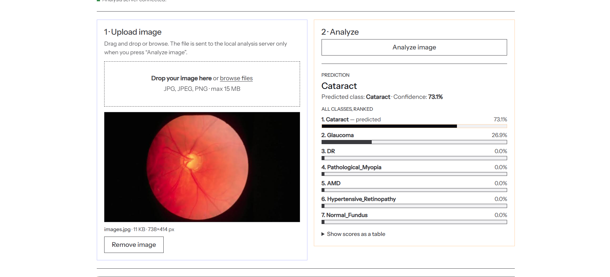

# Eye Disease Detection using Deep Learning

## Overview

Eye Disease Detection is a Deep Learning-based computer vision project developed to identify multiple eye diseases from retinal fundus images. The system uses Convolutional Neural Networks (CNNs) and Vision Transformer models to classify retinal scans into different disease categories with high accuracy.

The project also includes a custom Next.js + FastAPI web application that allows users to upload retinal fundus images and receive real-time disease predictions.

---

## Features

* Detection of multiple eye diseases from retinal images
* Deep Learning and Vision Transformer-based models
* Web application for real-time predictions
* Large-scale dataset handling (50,000 retinal images)
# RetinaVision AI

RetinaVision AI is a retinal fundus image classification project. Upload a JPG, JPEG, or PNG image to the web app to preview it, run the bundled model, and view the predicted category with a ranked score breakdown.

**Live app:** [retina-vision-ai.vercel.app](https://retina-vision-ai.vercel.app/)



The application is built with a Next.js frontend and a FastAPI inference service. The API preprocesses the uploaded image and runs a seven-class Keras model. The repository also contains Jupyter notebooks for the model development and experimentation workflows.

> **Important:** This is an educational AI classification demo, not a medical device or diagnosis. Model scores are not a substitute for clinical evaluation. Consult a qualified eye-care professional about retinal images or health concerns.

## Classification categories

- Age-related macular degeneration (AMD)
- Cataract
- Diabetic retinopathy (DR)
- Glaucoma
- Hypertensive retinopathy
- Normal fundus
- Pathological myopia

## How it works

1. Select or drag in a retinal fundus image.
2. Review the preview and choose **Analyze image**.
3. The frontend sends the image to the FastAPI service.
4. The service resizes the image to 224 x 224, applies the model's expected preprocessing, and returns the predicted class and ranked scores.

The API provides `GET /health`, `GET /classes`, and `POST /predict` endpoints. The prediction endpoint accepts an image as multipart form data under the field name `file`.

## Technology

- **Frontend:** Next.js 14, React 18, TypeScript
- **API:** FastAPI and Uvicorn
- **Model:** TensorFlow/Keras, with the bundled `server/stundent_model.keras` model
- **Research notebooks:** CNN, Vision Transformer, and knowledge-distillation experiments in `Final Code/`

## Run locally

Use Python 3.11 for the backend. From the repository root:

```bash
python -m venv .venv
```

Activate the environment, then install and start the API:

```bash
python -m pip install -r server/requirements.txt
python -m uvicorn server.main:app --reload --host 127.0.0.1 --port 8000
```

In a second terminal, start the frontend:

```bash
cd web
npm install
npm run dev
```

Open [http://localhost:3000](http://localhost:3000). In development, the Next.js rewrite proxies `/api/*` to `http://localhost:8000`. Configure `BACKEND_URL` to change the API target; see [`web/.env.example`](web/.env.example).

## Deploy

The deployed application uses separate Vercel and Render services:

### Render API

- **Root Directory:** `server`
- **Build Command:** `pip install -r requirements.txt`
- **Start Command:** `python -m uvicorn main:app --host 0.0.0.0 --port $PORT`
- **Python version:** 3.11 (for example, set `PYTHON_VERSION` to `3.11.11`)

Keep `stundent_model.keras` in the `server/` directory so the API can load it.

### Vercel frontend

- **Root Directory:** `web`
- **Environment variable:** `BACKEND_URL` set to the Render service origin, for example `https://your-api.onrender.com` (no trailing slash).
- `NEXT_PUBLIC_API_URL` defaults to `/api`; the frontend uses that path with its Next.js rewrite to reach the Render API.

## Repository layout

```text
web/                              Next.js frontend
server/                           FastAPI API, requirements, and Keras model
Final Code/                       Model development and experimentation notebooks
result.png                        Application screenshot
theme.md                          Frontend visual theme reference
README.md                         Project documentation
```

## Author

Srijith Chetla
